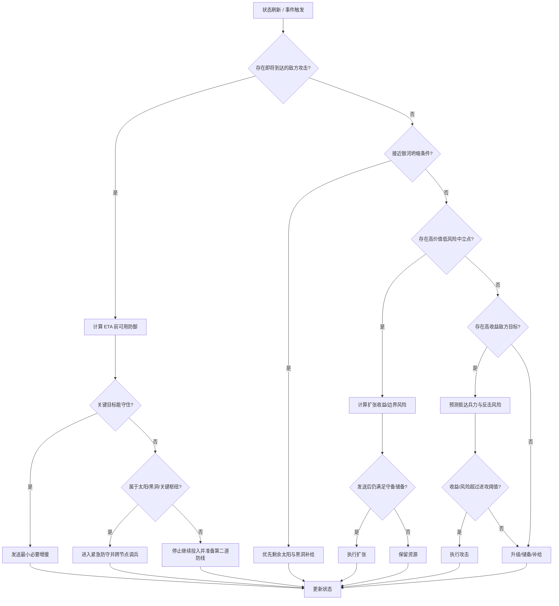

# 扩张、进攻与防守策略研究

> 本文是早期策略研究，包含尚未实现的设想，不是当前脚本的功能承诺。原报告的会话引用标记无法还原为可核查链接，已移除；规则数值与官方政策需重新核实后才能用于实现。当前行为见 [README](../README.md)，接入证据见[游戏接入研究](research.md)，实现约束见 [AGENTS.md](../AGENTS.md)。

## 摘要

Swarm MMO 的核心不是传统 RTS 中“多资源、多兵种、建筑队列”的优化，而是一个**持续运行、单位同质、空间距离影响显著、经济与军事完全共享同一资源池**的在线领地控制问题。官网当前规则显示：行星持续生产 Probe，行星升级提高产量；Probe 可以夺取行星，也可以在太阳处转换为 Super-probe，Super-probe 再可在黑洞处转换为 Megaprobe；太阳提供 Energy 用于科技，基地可消耗 Super-probe 换取 Energy 并提供科技覆盖；最终目标是在一个银河内控制全部太阳、控制黑洞并驻守 1,000 Megaprobe 后主动坍缩银河，以获得永久 Prestige。

对自动化策略而言，最重要的三个结论是：

第一，**早期扩张的边际收益通常高于高等级升级**。每个一级行星即提供 1 Probe/min，而从一级升二级需要 100 Probe、回本约 100 分钟；越高等级，升级回本时间以 \(100L^2\) 分钟增长。官网也明确建议“早期扩张”和“升级预计长期持有的行星”。

第二，真正的最优策略不是“最大化领土”，而是建立**前线—枢纽—后方三级网络**：后方负责产能和自动升级，枢纽靠太阳/基地获取科技覆盖并进行中继，前线只维持足够防御余量并向低风险目标扩张。由于攻击抵达时才结算，守军会在飞行期间继续生产，且发射位置决定速度，因此距离和“预计抵达时敌方兵力”应进入每次进攻决策，而不能只比较当前数字。

第三，自动化应尽量利用游戏**官方服务器端 Automation 与 Command Center**，而不是尝试高频浏览器操作。官方明确说明脚本化流量会触发 action burst throttle，浏览器动作还受浏览器检查约束；相反，服务器端 automation 不计入 burst throttle，并可在客户端关闭时持续运行。官方没有在公开规则中明确说明“第三方外部 Bot/宏”的允许边界，因此这一点应标记为**未指定**；策略实现不应绕过浏览器检查、限流或其他反自动化机制。

因此，本报告推荐一个**风险约束型分层策略**：先以低成本中立行星扩大生产面，再围绕太阳或基地形成科技覆盖区；前线推进采用“预测抵达兵力 + 风险缓冲 + 撤退阈值”，避免全仓压上；防守优先保太阳、关键枢纽和黑洞；自动化用事件触发和低频周期扫描结合，而非持续轮询。默认目标设为“长期提高 Prestige 获取速度”，而不是短期最大化行星数量。

## 游戏机制、约束与建模假设

### 原报告采用的机制假设（待重新核实）

Swarm MMO 是持续运行的浏览器 MMO。行星按照自身等级每分钟生产等量 Probe：一级 1/min，十级 10/min；Probe 没有容量上限，也不会衰减，因此“囤积”本身是一种可行策略。行星最高十级，升级从等级 \(L\) 到 \(L+1\) 需要 \(100L^2\) Probe，并增加 1 Probe/min 产量。

从资源建模角度，可以把游戏中的可消耗资源分成三层。第一层是 Probe，也是最基础的生产与战斗资源；第二层是 Super-probe，通常由 Probe 在太阳或基地相关目标上转换得到，基础兑换比为 100:1；第三层是 Megaprobe，Super-probe 在黑洞处以 100:1 转换。Energy 是科技货币，主要来自太阳；基地也可通过持续消耗 Super-probe 产生 Energy。Prestige 则属于永久账户级成长，它使每个太阳的 Energy/min 永久提高。

兵种本身非常简单：普通战斗只有 Probe，没有传统意义的坦克、远程、航空等兵种构成；Super-probe 与 Megaprobe 更多服务于太阳和黑洞层级目标。官网将这一设计概括为“一种单位”。

攻击在单位抵达目标时结算。要夺取行星，最终剩余攻击 Probe 必须严格多于守军；平局判定为防守方胜。关键点是结算依据**抵达时守军**而不是出发时守军，因此对方在飞行途中新增的生产必须纳入预测。多个来源的攻击不会合并成同一次战斗，而是按各自抵达先后独立结算；这在对方拥有 Toughness 科技时尤其重要，因为每一次独立防守都会再次触发损失恢复机制。

移动速度取决于**出发点在银河中的位置**：越靠银河边缘可高达基础速度约 4×，越靠核心最低约 0.25×。因此“短几何距离”并不一定等于“短飞行时间”，自动化应直接使用游戏提供或可观察的 ETA，而不是仅用欧氏距离。

跨银河攻击具有额外约束。新银河正常情况下前三天不可从外部攻击；边界开放后存在随银河年龄下降的损耗，官方当前文档列出从接近 100% 逐步下降到第 13 天的 0%。这种损耗同时作用于 Probe、Super-probe 和 Megaprobe，也作用于自动化发送。

太阳不会自行生成 Super-probe，其驻军只能由玩家发送。太阳同时产生 Energy，并提供固定半径为 8 grid units 的科技覆盖；由己方或盟友持有的基地也能提供科技覆盖，基地半径随等级从 1 增长到最高 10。多个覆盖区重叠不会叠加。

目前官方科技共九项，包括 Velocity、Construction、Defense、Assault、Toughness、Salvage、Navigation、Terraforming、Conversion。它们只在己方或盟友太阳/基地覆盖半径内生效。其中 Assault 与 Defense 分别影响行星攻击和防御有效战力；Velocity 改变飞行速度；Construction 增加产能；Navigation 减少跨银河损耗。

游戏存在 Clan。Clan 成员互为盟友，彼此发送单位会强化而不是攻击；官方介绍还指出成员共享视野，并可共同控制一个银河的全部太阳。完成银河坍缩时，持有该银河太阳的 Clan 成员也可获得 Prestige。

胜利条件已明确，不属于“未指定”：控制黑洞、使该银河全部太阳由自己或 Clan 盟友控制，并在黑洞驻守 1,000 Megaprobe 后可主动坍缩银河。坍缩会摧毁整个银河内的行星和太阳，同时给予永久 Prestige。

此外，银河在创建 14 天后进入不稳定状态，黑洞开始消耗自己的 Megaprobe 驻军，而且消耗量每日翻倍；若驻军耗尽，银河会自行坍缩且无人获得 Prestige。这意味着中后期的战略目标应从单纯扩张转向“是否值得投入黑洞驻军并完成坍缩”。

### 未指定或公开资料不足的内容

公开 Wiki 没有给出一个完整的“战争宣言/正式敌对状态”机制，实际关系可简化成己方、Clan 盟友、其他玩家、中立四类；更复杂的外交行为应标记为**未指定**。

官网有日志、战略地图、移动列表和共享视野等机制，但没有公开一个适合外部程序消费的、稳定版本化的实时游戏状态 API 规范，因此“第三方脚本能合法读取哪些数据、以什么频率读取”属于**未指定**。官方的 Command Center 是明确支持的自动化入口。

公开规则明确说明外部式高频 scripted traffic 会遇到 burst throttle 和浏览器检查，但未找到一份单独的“第三方 Bot/宏政策”。因此本文假设自动化只使用游戏明确支持的 Command Center、内建 automation，或不规避任何检查与限流的辅助决策工具；任何绕过限制的方式均不在策略范围内。

**实现难度：中。** 最大难点不是规则本身，而是将持续世界、飞行中单位、盟友行为和潜在敌方反应建模成动态状态。

**主要风险：** Patch Notes 显示 2026 年游戏机制仍在调整，例如 Command Center CPU、基地、边界距离和自动化阈值均曾发生变化，因此策略参数必须数据驱动，不能硬编码长期常数。

## 扩张策略

扩张算法不应把“最近的中立星球”作为唯一目标，而应计算一个**净战略价值**。建议对每个候选目标 \(i\) 定义：

\[
Score_i =
w_p P_i +
w_s S_i +
w_c C_i -
w_g G_i -
w_t T_i -
w_e E_i -
w_r R_i
\]

其中 \(P_i\) 为目标提供的未来生产价值，\(S_i\) 为战略位置价值，\(C_i\) 为太阳/基地科技覆盖协同价值，\(G_i\) 是预计抵达时所需攻击成本，\(T_i\) 是飞行时间成本，\(E_i\) 是扩张导致的边界暴露成本，\(R_i\) 是被敌人反夺的风险。

这一设计与游戏经济结构匹配：新增一级行星马上多 1 Probe/min，而将一级行星升到二级需要 100 Probe 才同样增加 1/min；因此，在目标守军很低、能守得住的情况下，拿新行星通常拥有更短的纯生产回本期。官方当前 Patch Notes 还指出中立行星驻军随位置变化：银河边缘可能只有 1–5 Probe，核心可高达约 200–1,000 Probe。

因此，自动化应将银河划分为三个区域：

**安全后方**：敌方到达时间长、近期无敌方扩张迹象。这里优先自动升级，尤其是预计长期保有的行星。官方自身的建议也是“升级你打算长期持有的行星”。

**过渡枢纽区**：靠近太阳或已供给基地，享有科技覆盖。这里的行星比孤立行星更有价值，因为 Construction、Defense、Assault、Velocity 等科技均可生效。

**前线区**：靠近其他玩家颜色边界或最近发生攻击的区域。这里只做低成本、易反应的扩张，默认不进行高等级升级；储备 Probe 用于防守和快速反攻。

何时扩张可以用以下触发逻辑：

```text
若存在低风险中立目标：
    预测目标抵达时驻军
    计算最低占领兵力 + 安全缓冲
    若发送后来源行星仍高于最低防御储备
       且新增边界风险低于阈值
       且目标生产回本期 < 当前升级备选回本期
    则扩张
否则：
    将盈余投入后方升级、太阳、基地补给或战略储备
```

安全缓冲建议不是固定数字，而是基于敌方反应时间动态计算：

\[
Reserve =
ExpectedIncoming_{H}
+
EnemyProduction_{H}
+
SafetyMargin
\]

其中 \(H\) 是“我方可从其他行星支援该点之前的时间窗口”。也就是说，越孤立的前线点，Reserve 越大。

多点扩张不建议完全并行。更稳妥的是“波次扩张”：先同时夺取 2–5 个明显低成本中立点，等待所有战斗和所有权状态稳定，再重新评估边界。这样可避免因为多次同时发送导致核心行星被抽空。官方 Command Center 已支持向最近未占领行星批量发送，并会跳过已有足够在途兵力覆盖的目标，这说明“防止过量叠加”本身也是官方自动化设计中的重要原则。

风险阈值建议定义为“发送后被一轮合理敌方攻击突破的概率”。在没有可靠概率模型时，可使用规则化阈值：前线来源最多发送可用盈余的 30%–50%；安全后方可提高至 60%–80%；如果附近敌人近期活跃，则统一下调。

### 扩张策略预期比较

| 策略 | 早期产能增长 | 防守稳定性 | Probe利用效率 | 被反打风险 | 适用阶段 |
|---|---:|---:|---:|---:|---|
| 极限抢中立 | 很高 | 低 | 高 | 很高 | 仅开局、敌人远 |
| 均衡扩张 | 高 | 高 | 高 | 中低 | 默认推荐 |
| 堡垒式升级 | 中低 | 很高 | 中 | 低 | 强敌邻接 |
| 太阳优先扩张 | 中 | 高 | 中高 | 中 | 中期科技争夺 |
| 多前线并行扩张 | 很高 | 低 | 中 | 很高 | 已有明显兵力优势 |
| 枢纽链式扩张 | 高 | 很高 | 很高 | 低至中 | 中后期推荐 |

这些表现属于策略推断而非官网统计数据，应作为待 A/B 测试验证的假设；其中太阳与基地覆盖能提供科技加成、前线暴露会增加防守压力等机制基础来自官方规则。

**优先级：** 免费/低驻军中立行星 > 能建立科技覆盖网络的目标 > 缩短补给线的连接点 > 普通高驻军行星 > 深入敌方领地的孤立点。

**实现难度：中。**

**主要风险：** 单纯按“中立成本最低”扩张会产生蜿蜒领土和过长边界；按“最近目标”扩张则可能错过更高战略价值的太阳周边。

## 进攻策略

进攻目标应分成四类，并用不同权重：敌方前线行星、经济核心行星、太阳、黑洞。攻击太阳和黑洞的战略价值远高于普通行星，因为太阳决定 Energy 和科技覆盖，并且全部太阳是最终坍缩条件；黑洞则直接关系银河胜利。

推荐的目标评分：

\[
AttackScore =
Value_{economic}
+ Value_{position}
+ Value_{tech}
+ Value_{collapse}
- Cost_{capture}
- Cost_{reinforcement}
- Risk_{counterattack}
\]

其中，普通“骚扰”目标只有在其作用大于占领成本时才值得攻击，例如切断敌方前线和后方之间的连接、迫使对方把 Probe 从另一个方向调走，或者夺取对方刚攻下但驻军极低的行星。

真正需要特别处理的是**多个来源的联合进攻**。官方规则显示，多路攻击不是一次合并战斗，而是多个独立抵达事件；防守方 Toughness 可能在每轮防守后恢复部分损失，因此“20+20+20”并不等价于“60 一次到达”。

因此自动化应优先选择以下顺序：

1. 能由单一来源以安全余量吃掉目标时，优先单点大包。
2. 必须多来源时，让 ETA 尽可能接近，降低敌方中间生产和恢复窗口。
3. 若无法同步 ETA，则先让第一波成为“削弱波”，第二波必须重新按第一波后的预计驻军计算。
4. 对高 Toughness 对手，减少碎片化攻击次数。

攻击发起条件建议为：

```text
预测目标抵达时有效守军 D
计算自身 Assault、对方 Defense
计算跨银河损耗和单位转换
得到最低攻击需求 A_min

若 A_available >= A_min × (1 + safety_margin)
   且来源发送后仍满足自身守备储备
   且预计增益 / 总成本 > 最低收益阈值
则允许进攻
```

安全余量可从 10%–20% 起步，但不应固定。对飞行时间长、敌方附近有多个增援点的目标，应提高到 30% 或更高；对刚刚被第三方攻击、驻军很低且 ETA 极短的目标，可以显著降低。

进攻时机中，有三种高价值窗口。

第一是**敌方刚刚扩张后**。通常进攻方刚把 Probe 发出去，新占领点残余驻军较低，原来源点也被削弱。

第二是**敌方大规模进攻期间**。如果可观察到大量敌军在途，应优先攻击其发射源而非正面硬接，形成“交换基地”的压力。

第三是**太阳争夺窗口**。太阳本身不生产 Super-probe，因此其驻军纯粹依靠补给；如果发现其补给线被拉长或前线太阳被频繁抽空，就比普通行星更值得攻击。

后勤上，建议建立“行星 → 太阳/基地附近枢纽 → 前线”的流，而不是让所有后方行星直接向前线发送。内建 automation 可让行星在达到阈值后向目标持续发送，也可让太阳继续向其他太阳或黑洞转发；每条 relay 至少间隔 60 秒才能再次触发，因此阈值太低会造成大量小包，阈值过高又会增加反应延迟。

推荐的阈值设计不是一个全局值，而是：

- 前线补给链：低阈值，优先及时性。
- 安全后方：中高阈值，减少频繁动作。
- 黑洞冲刺阶段：高阈值，形成大包，减少分散在途时间。
- 跨银河：只有当边界 toll 已低到足以接受成本时才自动发送，否则积累。

撤退本身在 Swarm MMO 中不是传统 RTS 的“单位掉头”概念，因此“撤退”应实现为**停止继续投资、回收可转移驻军、让不可守点自然放弃**。一旦某前线点满足“预计敌方到达兵力 > 本地驻军 + 可及时增援 × 防守倍率”，自动化不应继续向该点投入 Probe，除非该点属于太阳、关键枢纽或黑洞。

**优先级：** 防止本方关键点即将丢失 > 拿下敌方低驻军前线 > 夺取太阳 > 切断敌方网络 > 深入攻击高价值核心 > 无明确收益的骚扰。

**实现难度：高。**

**主要风险：** 最大误差来自未知敌方后续人工操作；因此算法不宜用“算出刚好+1”作为 PvP 攻击数量，官网的 exact-send 更适合静态或较确定的目标。

## 防守策略

防守应采用“少数高价值节点强防，大量普通前线柔性防守”的结构。由于 Probe 没有容量上限，所以后方存量可以自然积累成战略储备；完全平均驻防会导致大量单位被锁在低价值节点上。

建议对己方节点定义防御价值：

\[
DefensePriority =
ProductionValue +
TechCoverageValue +
LogisticsCentrality +
WinConditionValue +
EnemyPressure
\]

黑洞在中后期通常最高，因为它既决定是否能维持银河，又是坍缩条件的一部分；太阳次之，因为太阳产生 Energy 并投射科技；连接多个前线的中继行星再次之。普通边缘一级行星可以作为弹性缓冲区。

基地布局方面，基地与太阳最大的不同是它能建在空格，并且可以生存于银河坍缩之后；其最高科技覆盖半径达到 10，比太阳的 8 略大。理论上，基地最适合放在“太阳覆盖盲区 + 多个高等级行星密集区”或未来跨银河跳板区域。

不过基地成本非常高。当前官方 Wiki 显示基地机制在 2026 年曾有过改动；当前页面/搜索结果存在“初始中立驻军很高”的版本描述，因此基地建设应在运行时以游戏显示值为准，而不要把历史版本成本硬编码。

预警应利用三种信号：incoming movement、目标 under attack 状态、边界颜色变化。官方战略地图会显示攻击线，并使受攻击的行星、太阳或基地闪烁；日志也能记录 incoming launch、attacked、lost、supported 等事件。

防守决策建议：

```text
收到 incoming attack：
    估算敌方抵达量 E
    估算抵达时本地自然生产 P
    估算防御科技倍率 M
    计算可在 ETA 前到达的友军增援 R

    若 (Garrison + P + R) × M > E × safety_margin：
        仅发送必要增援
    否则若目标是关键节点：
        从多个近源抽调增援
    否则：
        停止继续投资该点
        将附近高价值单位保留用于第二道防线/反攻
```

多方向攻击时，不应使用“平均分兵”。应依据 ETA 排序，先解决最早到达且最可能突破的攻击；同时计算同一节点连续多波攻击，因为 Toughness 等机制会影响连续战斗结果。

修复与重建优先级建议为：重新夺回太阳或黑洞 > 恢复被切断的补给链 > 重建高生产后方 > 重新占据普通边缘点。基地如果因供给耗尽进入 dormant，则应优先重新供给，但只有当它的科技覆盖仍然具有明显价值。基地无 Super-probe 时不会产 Energy、不会提供科技，并且更易被夺取。

**优先级：** 黑洞 > 高争夺太阳 > 中继枢纽 > 高等级生产行星 > 普通边缘行星。

**实现难度：中高。**

**主要风险：** 自动防守最容易出现“援军黑洞”：所有后方不断向一个注定守不住的点投入资源。必须有明确的 Stop-Loss 条件。

## 自动化实现框架与决策流程

推荐使用**分层状态机 + 优先级事件队列**，而不是一个统一的巨大行为树。最上层负责战略阶段，下层负责每个节点和每个行动的局部判断。

全局状态可以分为：`EXPAND`、`CONSOLIDATE`、`DEFEND`、`OFFENSIVE`、`COLLAPSE_PUSH` 五类。

`EXPAND`：附近仍有大量高性价比中立目标。

`CONSOLIDATE`：边界开始接触其他玩家，主要进行升级、储备、建立太阳/基地覆盖网络。

`DEFEND`：存在高风险 incoming attack，临时抢占最高优先级。

`OFFENSIVE`：自身相对实力显著领先，开始夺取敌方前线和太阳。

`COLLAPSE_PUSH`：已经接近控制全部太阳，战略资源集中到黑洞 1,000 Megaprobe 与剩余太阳。官方当前坍缩条件正是全部太阳 + 黑洞驻军 1,000 Megaprobe。

推荐事件优先级：

1. 即将丢失黑洞/太阳
2. 即将丢失关键中继节点
3. 可低成本夺取敌方太阳
4. 可低成本反夺刚丢失节点
5. 有高价值中立扩张
6. 行星升级
7. 基地补给
8. 普通骚扰

自动化频率应事件驱动优先。Incoming attack、ownership change、capture、loss 等事件应该立刻触发局部重评；没有事件时，可以每 30–120 秒重算一次局部策略，而不是每秒扫描全部宇宙。官方 automation 自己就存在 60 秒最短 relay 间隔，Command Center schedule 最短为 15 分钟，因此高频毫秒级循环没有游戏层面的意义。

Command Center 有独立 CPU 池，当前官方文档写明池上限 10,000，恢复速度 60 CPU/min；不同动作成本差异很大，例如设置 automation 通常较低，而向最近未占领星球或指定玩家发送属于高成本动作。大规模自动化应把“设置长期服务器 automation”看成投资，把高频批量发送看成昂贵行为。

推荐自动化决策流程如下：



容错应覆盖以下几类异常：目标已换主、目标消失、Automation 因被夺取而被清除、Command Center preset 目标不存在、CPU 不足、action 被 burst throttle 拒绝、银河边界状态变化。官方明确说明 conquest 会清除自动化，Command Center preset 若目标失效可能停止运行；大规模命令也可能因 CPU 不足被跳过。

因此每次动作必须满足**幂等性**：失败后再次评估当前状态，而不是盲目重复动作。尤其不能“收到拒绝 → 立即无限重试”，否则会进一步触发限流。

可测试性方面，应为每个决策记录以下解释字段：触发事件、候选目标、预计成本、预计收益、最低守备、选择原因、拒绝其他候选的原因、最终结果。这样才能区分“算法算错”和“敌方在执行后人工改变局势”。

**实现难度：高。**

**主要风险：** 状态可能在计算和执行之间变化，因此必须接受最终一致性，而不能假设所有判断具有原子性。Command Center 本身在大帝国中也是按最多 200 个变化为一批处理，并在执行过程中重新检查 live probe counts，这说明游戏官方也采用了动态重检。

## 评估、A/B 测试与参数调优

不建议只用“行星数”评价策略，因为行星数可以通过过度扩张迅速提高，却同时降低长期生存率。至少应同时记录以下指标：

- **Prestige velocity**：每单位真实时间获得的 Prestige，最接近长期总目标。
- **Net probe production**：当前所有行星总 Probe/min。
- **Probe efficiency**：每获得 1 Probe/min 永久产能消耗多少 Probe。
- **Combat exchange ratio**：敌方损失 / 我方损失。
- **Territory retention**：新占领目标在 30、60、180 分钟后仍被持有的比例。
- **Sun uptime**：太阳处于己方控制的时间比例。
- **Critical loss count**：太阳、黑洞或关键中继点丢失次数。
- **Time-to-objective**：达到指定太阳控制率、黑洞控制或可坍缩状态所需时间。
- **Action/CPU efficiency**：每 1,000 CPU 或每次主动动作带来的净收益。
- **Defense overcommitment**：投入到最终仍丢失目标的 Probe 数量。

A/B 测试时，不能简单把两个策略放在不同真实服务器时段比较，因为对手行为差异会压过参数差异。更合理的方法是构建**事件重放仿真**：保存一段真实地图状态和之后的敌方移动，分别让 A、B 两套决策器在相同初态下做离线推演。

首批建议测试四组参数：

**扩张缓冲 A/B**：发送后保留 30% vs 50% 兵力。比较产能增长、前线丢失率和 Probe 交换比。

**升级策略 A/B**：所有安全行星自动升级 vs 仅“预计持有时间大于升级回本期”的行星升级。升级回本期可以直接由官方公式 \(100L^2\) 分钟得到。

**进攻安全边际 A/B**：预计最低兵力 ×1.15 vs ×1.30。观察进攻失败率和多投入资源。

**太阳防御 A/B**：固定驻军目标 vs 基于邻敌 ETA 动态驻军。由于太阳不自行生产 Super-probe，理论上动态驻军应明显降低闲置资本，但该假设需要测试。

参数调优不建议直接用复杂强化学习起步，因为真实 MMO 环境非平稳且采样昂贵。优先采用网格搜索或贝叶斯优化，调少量可解释参数，例如：

```text
frontier_reserve_ratio
attack_safety_margin
max_parallel_expansions
sun_defense_multiplier
upgrade_min_holding_time
enemy_activity_decay
collapse_push_threshold
cross_galaxy_max_toll
```

仿真场景至少应覆盖：无敌开局、两人对称接壤、己方经济领先但前线狭长、敌方集中攻击太阳、双线进攻、Clan 盟友协防、跨银河 90% toll、跨银河 0% toll、黑洞进入不稳定期、坍缩冲刺。

建议最终优化目标不是单指标，而是：

\[
Utility =
\alpha \cdot PrestigeRate
+
\beta \cdot ProbeProduction
+
\gamma \cdot SunControl
-
\delta \cdot ProbeLoss
-
\epsilon \cdot CriticalLoss
\]

其中 \(\delta,\epsilon\) 在高风险阶段提高，使系统自然从进攻模式切换为守势。

**实现难度：中高。**

**主要风险：** 对真实玩家过拟合。某个参数在特定对手上效果好，不代表普适；必须按对手活跃度、科技水平和地图位置分层统计。

## 同类游戏参考、可借鉴原则与待补充清单

可供比较的同类游戏包括 **Galcon**、**Eufloria** 和移动端的 **State.io**。Swarm MMO 官方本身专门提供了与 Galcon、State.io、Eufloria 的对比页面。

Galcon 的相似度最高。官方 Galcon 网站描述的核心玩法就是从一个行星向另一个行星发送舰群、争夺整个银河，并提供单人玩法；Swarm MMO 官方也明确指出两者共享“从己方行星拖到目标、发送一部分单位”的核心操作。

Galcon 可直接借鉴三点：**生产率优先、兵力集中、空虚点反打**。Planet Wars/Galcon 类策略的经典 AI 问题本质上就是持续生产节点之间的兵力流分配，因此其“目标价值 = 生产能力 − 占领成本 − 距离成本”非常适合作为 Swarm MMO 扩张评分的起点。不同点是 Swarm MMO 没有短局结束机制，单位可无限囤积，并存在科技、太阳、黑洞、Clan 与跨银河成本，所以不能照搬 Galcon 的“全力争夺当前地图”思路。Swarm MMO 官方特别强调了这一差异：Galcon 是几分钟一局，而 Swarm MMO 地图持续存在。

Eufloria 也是很强的候选。它拥有单人战役，玩家通过控制小行星生产 Seedlings，再派它们去占领其他小行星；Nintendo 和开发者相关页面均描述了其单人 Story Mode 和探索/征服循环。

Eufloria 最值得借鉴的是**节点专业化和供应链思维**：不是每个节点都同时承担扩张、产兵和防守，而是让部分节点充当生产核心，前沿节点承担战略控制。这与本文推荐的“后方—枢纽—前线”三级网络高度一致。

State.io 的操作范式也相近，但它更偏短局 AI 关卡。Swarm MMO 官方描述 State.io 为一分钟左右的关卡式占领游戏，而 Swarm MMO 的最大不同是对手是真人、世界持续存在。因此 State.io 中“不断把全部单位向前推”的高节奏策略在 Swarm MMO 中风险很高。

综合这些参考，可以提炼出最适合 Swarm MMO 的策略框架：**Galcon 的生产—距离—兵力流优化 + Eufloria 的节点分工 + MMO 的持久风险管理**。

当前仍建议进一步补充或在实际脚本环境中确认的信息包括：外部自动化脚本的正式允许范围与 ToS 边界目前公开资料**未指定**；若使用 Command Center，则需要确认租赁与 CPU 预算；Clan 是否固定协作、盟友是否可靠会显著改变防守阈值；当前科技等级会改变 Assault、Defense、Velocity、Construction 等模型参数；核心目标是排行榜、单银河快速 Prestige、长期生存还是 PvP 击退率，也会改变目标函数。

如果默认目标是“长期 Prestige 效率 + 不容易被打崩”，最推荐的起始参数思想是：**前期偏扩张、中期围绕太阳形成科技覆盖网、前线只保最低必要守军、后方持续升级、进攻只打显著正收益目标、接近全太阳控制时立即切换为坍缩冲刺模式**。这一策略符合官网当前的经济、科技和胜利条件，而不依赖超高频操作、规则漏洞或绕过服务器限制。
